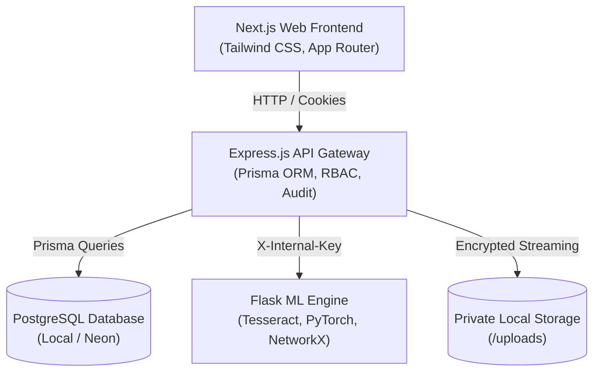

# Intelligent KYC & Loan Document Processing Platform with Fraud Detection

An end-to-end, privacy-preserving, AI-assisted KYC and Loan Document Verification platform designed to detect application fraud, verify documents, analyze bank statements, and enforce enterprise Maker-Checker approval governance.

---

## Architecture Overview



---

## The 10 Core Modules

| Module | Name | Key Functionality |
|---|---|---|
| **Module 4** | Authentication & RBAC | JWT in httpOnly cookie, 6 roles, Maker-Checker separation |
| **Module 17** | Audit Logging | Immutable append-only trail of all application events |
| **Module 16** | Privacy, Masking & Consent | Explicit applicant consent records and default PII masking (`XXXX-XXXX-1234`) |
| **Module 6** | Information Extraction & Validators | Verhoeff Aadhaar algorithm, PAN/IFSC regex, age checks |
| **Module 7** | Cross-Document Verification | RapidFuzz multi-document string and field comparison |
| **Module 8** | Forgery Detection (Lite) | PDF producer metadata tampering, arithmetic sum checks, font mixing |
| **Module 9** | Bank Statement Analyzer & Risk Score | Monthly credits, income regularity, EMI burden, transparent 0-100 risk score |
| **Module 12** | Plain Explanations & Trust Routing | Jinja2 plain-language summaries, `FAST_TRACK` / `OFFICER_REVIEW` / `ESCALATE` |
| **Module 13** | Fraud Ring Detection | NetworkX bipartite graph detecting shared phone/address clusters |
| **Module 10** | Tamper-Evident Hash Chain | Cryptographic SHA-256 block ledger verifying stored document integrity |

---

## Demo Accounts

All demo accounts come seeded with default credentials for evaluation:

| Role | Email | Password | Allowed Capabilities |
|---|---|---|---|
| **Applicant** | `applicant@kyc.local` | `Demo@1234` | Submit applications, view personal masked status |
| **Loan Officer** | `officer@kyc.local` | `Demo@1234` | Review assigned applications, submit recommendations |
| **Credit Manager** | `manager@kyc.local` | `Demo@1234` | Maker-checker final signoff, approve/reject |
| **Fraud Analyst** | `fraud@kyc.local` | `Demo@1234` | Inspect bipartite fraud ring graph, flag clusters |
| **Auditor** | `auditor@kyc.local` | `Demo@1234` | Read-only inspection of masked audit log trail |
| **Admin** | `admin@kyc.local` | `Demo@1234` | User role administration, system metrics |

---

## Quick Start Setup

### Prerequisites
- Node.js v18+ & npm
- Python 3.10+
- Docker Desktop & Docker Compose
- Tesseract OCR (with English pack)

### Running with Docker Compose (Recommended)
```bash
# 1. Copy environment configurations
cp .env.example .env

# 2. Build and start all services
docker compose up --build
```

### Manual Local Development
```bash
# Backend
cd backend
npm install
npx prisma migrate dev
npm run dev

# ML Service
cd ml-service
python -m venv venv
source venv/bin/activate  # or venv\Scripts\activate on Windows
pip install -r requirements.txt
python app.py

# Frontend
cd frontend
npm install
npm run dev
```

---

## Synthetic Data Generator & Seeding
```bash
cd data-generator
python generator.py --all-cases
npm run seed  # Loads synthetic cases and demo users into PostgreSQL
```

---

## Testing & Quality Assurance
```bash
# Backend RBAC, Maker-Checker & Masking Tests
cd backend && npm test

# ML Service Validators & Checksum Tests
cd ml-service && pytest
```

---

## Screenshots & Interface Walkthrough
*(Screenshots will be attached following Phase 1-7 UI milestones)*
