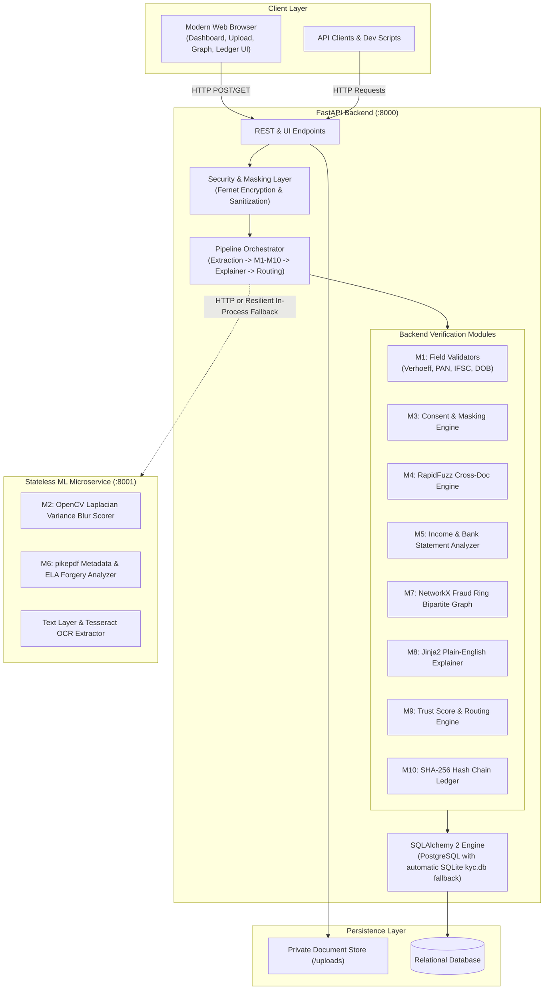
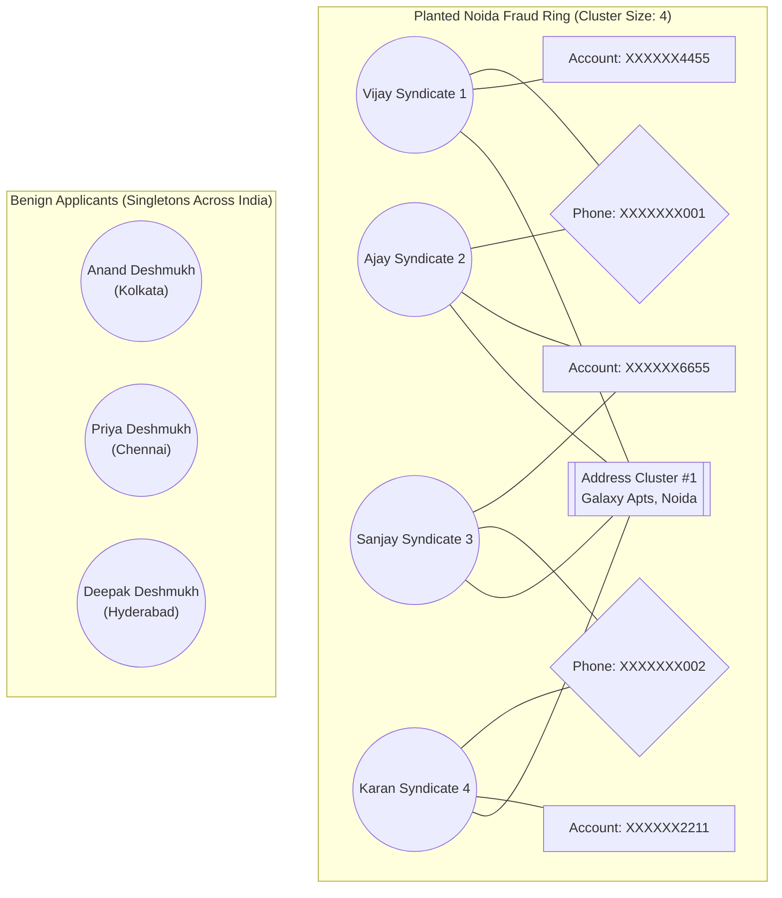

# System Architecture & Technical Specifications

## 1. System Overview

The Intelligent KYC & Loan Document Verification Platform is built with a resilient, modular microservice architecture designed to automate identity verification, document forensics, financial analysis, and anti-fraud syndicate detection.

---

## 2. Cryptographic Hash Chain Ledger (Module 10)

Every uploaded document is stamped into an immutable sequential SHA-256 block chain upon ingestion.

```mermaid
flowchart LR
    subgraph Genesis ["Block #0 (Genesis)"]
        G_Prev["prev_hash:<br/>0000...0000 (64 zeros)"]
    end

    subgraph Block1 ["Block #1 (Document 1)"]
        B1_Prev["prev_hash: G_Hash"]
        B1_Data["file_sha256<br/>document_id<br/>doc_type<br/>created_at_utc"]
        B1_Hash["record_hash:<br/>SHA256(prev || sha || id || type || time)"]
    end

    subgraph Block2 ["Block #2 (Document 2)"]
        B2_Prev["prev_hash: Block1.record_hash"]
        B2_Data["file_sha256<br/>document_id<br/>doc_type<br/>created_at_utc"]
        B2_Hash["record_hash:<br/>SHA256(prev || sha || id || type || time)"]
    end

    subgraph BlockN ["Block #N (Document N)"]
        BN_Prev["prev_hash: Block(N-1).record_hash"]
        BN_Data["file_sha256<br/>document_id<br/>doc_type<br/>created_at_utc"]
        BN_Hash["record_hash:<br/>SHA256(prev || sha || id || type || time)"]
    end

    Genesis --> Block1 --> Block2 --> BlockN
```

### Verification Walk
When verifying ledger integrity (`GET /api/integrity/verify` or UI Integrity tab):
1. **Linkage Check**: Confirms `block[i].prev_hash == block[i-1].record_hash`.
2. **Payload Recomputation**: Re-computes SHA-256 over stored block payload fields.
3. **Physical File Disk Check**: Reads physical file on disk, recomputes SHA-256, and compares with `file_sha256` recorded in the immutable block. Any byte alteration on disk immediately breaks verification and identifies the offending block.

---

## 3. Fraud Ring Bipartite Graph (Module 7)

- **Graph Structure**: Bipartite graph connecting Applicant nodes with Identifier nodes (Phone, Account Number, Address Clusters).
- **Address Clustering**: Fuzzy grouping using RapidFuzz `token_set_ratio` >= 92.0.
- **Syndicate Policy**: Any connected component containing >= 3 applicant nodes triggers `FRAUD_RING_SUSPECTED` (Red severity, -35 score impact). 2 applicants sharing an identifier trigger `SHARED_IDENTIFIER` (Amber severity, -15 score impact).
- **Privacy Enforcement**: Network node labels and hover tooltips strictly mask all PII (e.g. `XXXXXXX001`, `XXXXXX4455`). Identifier node IDs in the underlying graph use cryptographic SHA-256 hashes of normalized strings so raw numbers never enter the HTML or client payloads.
